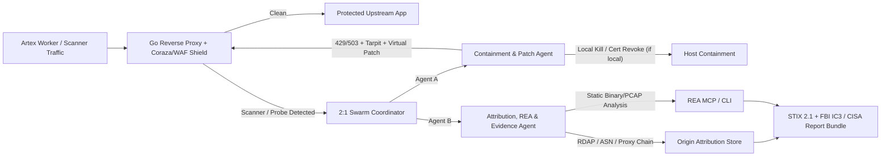

# Artex Antidote — 2:1 Autonomous Defender Swarm, Attribution & Federal Reporting Architecture

> **Status:** Draft Specification (EGM Elephant Phase)
> **Legal & Safety Boundary:** Strictly defensive. All attribution, containment, virtual patching, tarpitting, and evidence packaging operate exclusively on operator-owned perimeters, hosts, and captured artifacts. **No offensive counter-hacking ("hack-back") against external third-party infrastructure.**

---

## 1. Goals & Non-Goals

### Goals
1. **2:1 Defender-to-Attacker Swarm Ratio:** For every detected Artex attacker worker/session stream (clustered by source IP, session, TLS/HTTP fingerprint, or scanner signature), spawn **two** specialized defender agents:
   - **Agent A (Containment & Patch Agent):** Virtual-patches probed endpoints, applies `429`/`503` backoff traps and decoy/tarpit responses to exhaust Artex's `50,000`-token / `10`-turn worker budget, and optionally shuts down unauthorized local Artex processes/containers.
   - **Agent B (Attribution, REA & Evidence Agent):** Captures all source IPs, proxy headers, ASN/RDAP metadata, and timestamps; invokes **REA (`reverse-engineer-anything`)** statically on any captured payloads/binaries/PCAPs to extract hardcoded C2/origin indicators; and compiles **STIX 2.1** + **FBI IC3 / CISA** incident reporting bundles.
2. **World-Class Open-Source Stack Integration:**
   - **Go (`1.26+`)** core for high-concurrency reverse proxy, tarpit sockets, and swarm coordination.
   - **Coraza WAF (`corazawaf/coraza`) + OWASP CRS v4** patterns for embeddable request inspection and virtual patching.
   - **CrowdSec (`crowdsecurity/crowdsec`)** integration (log/alert export + bouncer compatibility) for community & edge IP banning.
   - **STIX 2.1** JSON bundle generation + **RDAP/ASN** lookup for federal reporting (CISA / FBI IC3).
3. **Operator Skill Book (`skills/`):** Modular `SKILL.md` runbooks enabling operators to deploy, tune, hunt, run REA forensics, and export federal incident reports.

### Non-Goals
- No unauthorized scanning, exploitation, or remote shutdown of external third-party servers.
- No live execution of untrusted captured binaries on the host (REA static inspection only).

---

## 2. Artex Threat Model & Choke Points (Observed from Source)

From inspecting the ARTEX autonomous-scanner source (the modeled threat):
- **Planner–Worker Loop (`agent/planner.go`):** Event-driven planner dispatches intents to workers; stops when remaining budget falls below the wrap-up reserve (`BudgetMarginPercent = 5%`, `BudgetMarginMinTokens = 20_000`, `BudgetMarginMinTurns = 2`).
- **Noise Governor (`agent/noise_profile.go`):** Forces workers to back off on HTTP `429` / `503` and rate-limits `nmap`, `nuclei`, `httpx`, `katana`, `ffuf`, `dalfox`, `sqlmap`, `bbot`.
- **HTTP Client (`agent/user_agent_test.go`):** Uses configured `User-Agent` or falls back to `Go-http-client/`.
- **Local Footprint (`README.md`):** Web UI on `:8787`, MITM recording proxy on `:8788`, Chrome/Edge extension (`extension/`), PostgreSQL backend.

---

## 3. System Architecture

---

## 4. Goldfish Stress-Test Summary (6 Lenses)

1. **Contrarian / YAGNI:** Keep the Go core dependency-light (standard library `net/http/httputil`, `net`, `crypto/sha256`, `encoding/json`) with clean pluggable interfaces for Coraza/CrowdSec/REA CLI so it compiles and runs immediately without external DBs.
2. **Cost & Concurrency:** Bound tarpit goroutines (`MaxTarpitConns`) and per-IP state maps with TTL eviction so an attacker flood cannot OOM the defender.
3. **Operator Ergonomics:** Single CLI binary (`artex-antidote`) with `serve`, `swarm-status`, `audit-host`, `rea-analyze`, and `export-report` subcommands, plus clear `skills/` runbooks.
4. **Backward Compatibility & Safety:** Virtual patches and firewall rules default to dry-run/log-only unless `--enforce` is passed; host containment never kills PIDs without explicit confirmation or `--auto-kill`.
5. **Observability & Forensics:** Every blocked/tarpitted request logs UTC timestamp, source IP, `X-Forwarded-For`, User-Agent, JA3/header hash, matched rule, and SHA-256 of any request body—preserving chain-of-custody for IC3/CISA.
6. **Long-Term Maintainability:** Strict separation between `internal/shield` (HTTP proxy, detector, tarpit), `internal/swarm` (2:1 coordinator + Agent A/B), `internal/attribution` (RDAP/ASN + REA bridge), `internal/reporter` (STIX 2.1 + IC3/CISA markdown/JSON), and `internal/hostaudit` (local Artex detector).
